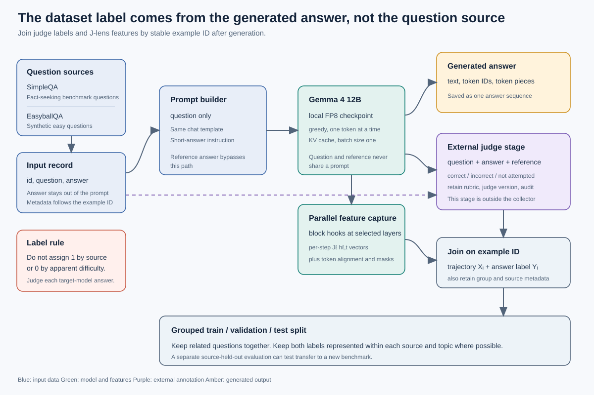
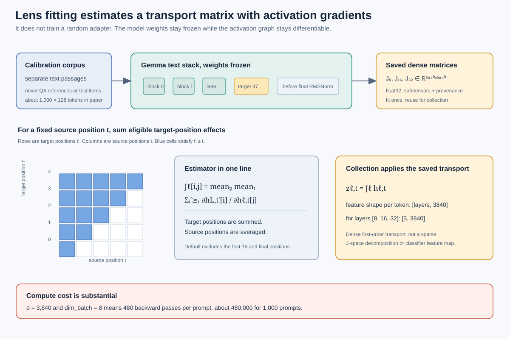
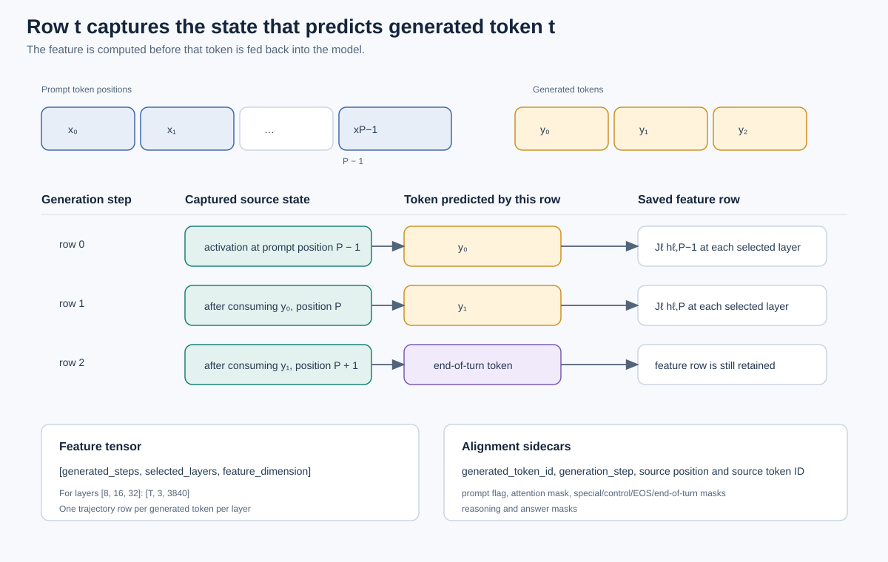
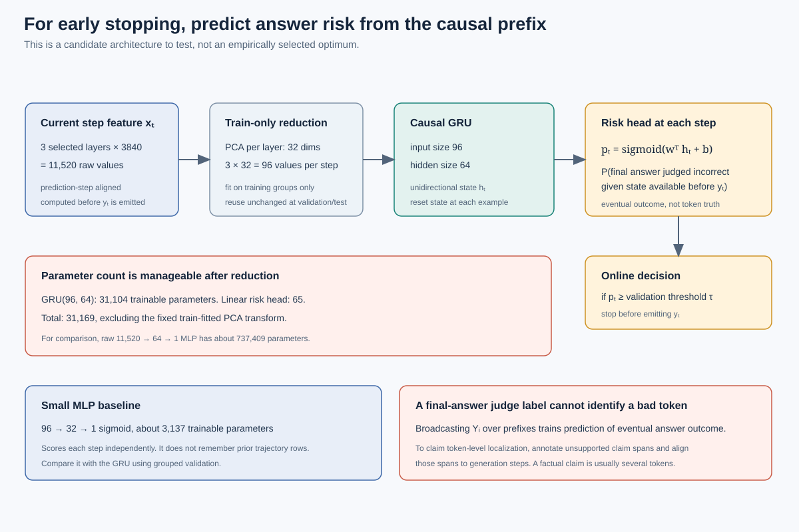
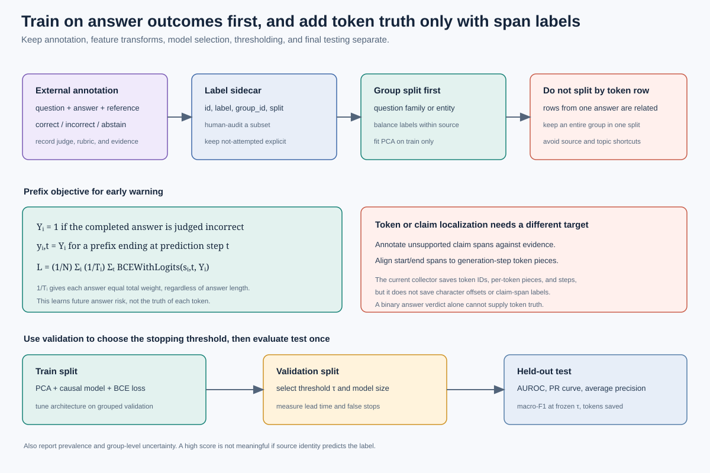

# Classifier design for prediction-step trajectories

This note describes a downstream experiment for the Hallucinot files. It does not add a grader or classifier to the collection pipeline. The recommended model sizes are starting hypotheses. There is no labeled Gemma 4 trajectory set here from which to determine an empirical optimum.

## The experiment in one picture











## Correct the label assumption first

SimpleQA supplies fact-seeking questions and reference answers. It does not assign every answer generated by Gemma a hallucination label. Its official grading distinguishes `CORRECT`, `INCORRECT`, and `NOT_ATTEMPTED`. The benchmark paper describes 4,326 questions, and the authors report grader and answer-key disagreements in a manual review. A benchmark name therefore cannot stand in for a per-generated-answer outcome. See the [SimpleQA paper](https://cdn.openai.com/papers/simpleqa.pdf), [SimpleQA introduction](https://openai.com/index/introducing-simpleqa/), and [official grader code](https://github.com/openai/simple-evals/blob/main/simpleqa_eval.py).

EasyballQA is a proposed synthetic set, not a guaranteed zero-error set. Gemma may make arithmetic mistakes, follow malformed prompts incorrectly, or emit an unparseable answer. Judge its actual output too.

If every SimpleQA row is labeled 1 and every EasyballQA row is labeled 0, source, domain, question style, answer length, and label become entangled. The model can learn “factoid benchmark versus arithmetic prompt” without learning hallucination risk. Include both outcomes within each source and topic where possible. Correct Gemma answers on SimpleQA are especially useful negative examples. Preserve the source field and run a separate source-held-out evaluation if cross-benchmark transfer matters. Keep the final test prevalence representative of the deployment setting, even if the training set is balanced.

Use the judge as a downstream annotation stage. Give it the question, generated answer, reference answer, and a clear rubric. Keep at least these verdicts separate:

| Verdict | Interpretation | Suggested binary treatment |
|---|---|---|
| `CORRECT` | Answer is supported by the reference and rubric | 0 |
| `INCORRECT` | Answer contains a contradicted or unsupported factual claim | 1, if that is the prespecified target |
| `NOT_ATTEMPTED` | Refusal or no factual attempt | Keep separate, or exclude from the binary fit |
| `UNCERTAIN` | Ambiguous question, incomplete reference, or judge uncertainty | Adjudicate or exclude, with a reason |

For answer-level incidence, define an answer as positive when at least one material factual claim is unsupported or contradicted. Save the judge model/version, prompt or rubric hash, verdict, rationale, evidence source, and human-audit status. Audit a stratified subset of verdicts against people and reliable evidence. Do not train on the judge's rationale text.

## What the current collector contributes

For every generated tokenizer token, the collector saves:

```text
j_transport[t, layer, feature]       float32 dense J_l h_l
readout_top_ids[t, layer, k]         top-k vocabulary IDs
readout_top_logits[t, layer, k]      corresponding logits
generated_token_ids[t]               generated token ID
source_activation_position[t]        prompt-plus-generation position used to predict it
source_token_id[t]                   token at that source position
is_answer_token[t]                    answer-channel mask
is_special_token[t], is_control_token[t]
is_eos_token[t], is_end_of_turn_token[t]
is_reasoning_token[t]
```

The leading trajectory axis is prediction step. Row `t` contains the activation used to predict generated token `t`. The token has not yet been fed back at that row. For three selected layers on the official Gemma 4 12B configuration, the shape is `[T, 3, 3840]`; it varies if the checkpoint or layer selection changes. The reference answer is saved in `records.jsonl`, not passed to the model prompt.

The saved `is_answer_token[t]` mask describes generated token `y_t`, while `j_transport[t]` is the state that predicts `y_t`. Treat the mask as a target/eligibility annotation, not as an input feature. At inference, any rule that gates on the proposed candidate token or channel must be reproduced before committing that candidate. The simplest first online experiment scores every eligible generation step and explicitly skips EOS, end-of-turn, and control-token candidates.

`j_transport` means dense first-order Jacobian transport. It is not an exact sparse J-space coordinate or a classifier output. The lens matrix is fit once from separate calibration text, with the final text-block output as its target, then reused during collection.

### Example answer-level label sidecar

Keep annotations out of `records.jsonl` so the original collection remains immutable and unlabeled outputs remain usable:

```csv
example_id,verdict,label,group_id,source,topic,split,judge_id,rubric_version,evidence_uri,human_audited
<stable-id>,INCORRECT,1,<question-family>,SimpleQA,<topic>,train,<judge-version>,v1,<evidence>,false
```

The row above is a schema illustration, not a real Gemma result. Split by question family, entity, or near-duplicate group before expanding answers into token prefixes. A group must appear in only one of train, validation, or test. Ensure both labels and both benchmark sources appear in the primary splits where data permits.

## Two different token-level questions

An answer-level judge verdict does not say which token is false. Tokenization divides text into pieces, while factual errors usually belong to a claim spanning several pieces. These targets must not be conflated.

### 1. Predict whether the completed answer will be wrong

Let `Y_i` be the final answer verdict for example `i`, where `1` means incorrect. At prediction step `t`, feed feature rows `x_0, ..., x_t` to the causal model. Row `x_t` is available before emitting token `y_t`; the observed text prefix ends at `y_(t-1)`. Predict `Y_i` from that state. This is a useful early-warning task. It asks:

> Given the model state so far, will this completed answer eventually contain an incorrect claim?

It does not ask whether the next token itself is false. To avoid long answers dominating the loss, average token-prefix loss within each answer before averaging across answers. Use a fixed set of prefix positions or controlled random-prefix sampling during training. Report performance at explicitly chosen prefix lengths and report earliest successful warning on positive examples.

### 2. Predict a wrong claim before it begins

For the stronger stopping claim, annotate the first unsupported claim and align its span to generated-token steps. The current collector saves token IDs, per-token decoded pieces, and steps, but does not save character offsets or claim-span labels. Add a reviewed span annotation keyed by example ID, with `claim_id`, `token_start_step`, `token_end_step`, verdict, and evidence. Verify token alignment rather than assuming independently decoded token pieces concatenate exactly to the final text.

Then train a discrete-time hazard target: before the first bad claim, predict whether that claim begins at the next step. At the annotated onset the target is 1; earlier at-risk steps are 0; steps after onset are not at risk for first-onset prediction. Correct answers are right-censored no-event sequences. This supports the claim “warn before the first bad claim” in a way an answer-level 0/1 label cannot.

Do not describe repeated answer-level labels on every token as token truth. They are weak labels for predicting the final answer outcome.

## A defensible first model configuration

The deployment goal is sequential early warning. A small **unidirectional GRU** is a more natural primary candidate than an MLP over a flattened whole answer because it can emit a score after each observed prefix and cannot read future tokens. An MLP is still useful as a simple comparison.

For the requested layers `[8, 16, 32]`:

1. Each step begins with `3 × 3840 = 11,520` dense transport values.
2. Fit a PCA independently for each layer on training examples only. Try 16, 32, and 64 components per layer. The initial 32-component setting gives 96 values per step.
3. Feed the prefix sequence `[T, 96]` into a one-layer, unidirectional GRU with hidden size 64.
4. Apply a dropout layer to the GRU output during training, then a linear `64 → 1` risk head.
5. Apply sigmoid to obtain `p_t`, the estimated probability that the completed answer will be judged incorrect given feature rows through `x_t`, before token `y_t` is emitted. The online wrapper must compute this score before it commits the next token. The current collector records trajectories but has no stop gate.
6. At inference, compare `p_t` with a threshold selected on validation data. A live decoding wrapper can stop before committing the next generated token if the threshold fires.

For a standard PyTorch GRU, input size 96 and hidden size 64 use 31,104 recurrent parameters. The linear output head uses 65, for 31,169 total trainable parameters, excluding PCA. PCA has 3 × 3840 × 32 fitted coefficients, but it is a train-fitted transform rather than a learned classifier layer. Save those PCA bases and the scaler with the classifier. Save the layer order, lens artifact hash, collection run compatibility hash, label rubric/version, group split manifest, and stopping threshold with the classifier artifact.

A compact per-step MLP baseline after the same PCA is `96 → 32 → 1`, about 3,137 trainable parameters. It sees only the current step vector. The transformer residual already contains prompt context, but the MLP does not explicitly model changes across the saved trajectory. A raw MLP `11,520 → 64 → 1` has about 737,409 parameters and is a high-overfit starting point when the number of independent labeled answers is modest.

These are starting configurations, not an asserted optimum. Select the number of PCA components, GRU width, and regularization using grouped validation or nested grouped cross-validation. Include at least a regularized logistic-regression baseline. Compare layer subsets using training/validation only. Do not pick layers, PCA size, architecture, or threshold after looking at test performance.

## Training objective

For the answer-level prefix task, let `s_i,t` be the risk logit at prefix `t`, and let `T_i` be the number of training prefixes used for answer `i`:

\[
\mathcal{L}
= \frac{1}{N}\sum_{i=1}^{N}
  \frac{1}{T_i}\sum_{t\in\mathcal{S}_i}
  \operatorname{BCEWithLogits}(s_{i,t},Y_i).
\]

This is binary cross-entropy with logits. Implement it with `BCEWithLogitsLoss` or its unreduced form. The division by `T_i` gives each answer equal total weight if every answer contributes multiple prefixes. If classes are imbalanced, compute any positive-class weight from training labels only and evaluate on the natural class distribution. Weighted training can distort probability calibration, so still select the operating threshold on validation data.

For annotated claim-onset prediction, use the discrete-time hazard likelihood instead. Do not use answer-level BCE as though it were a token-span loss.

## Evaluation for a stopping system

Use three disjoint, group-aware splits. Keep the test split untouched until the model, PCA size, stopping threshold, and preprocessing are fixed. Scikit-learn's [`GroupShuffleSplit`](https://scikit-learn.org/stable/modules/generated/sklearn.model_selection.GroupShuffleSplit.html) illustrates group isolation; stratification must also be considered because grouped splits may not preserve class balance.

On held-out answers, report:

- **AUROC** from continuous risk scores. It measures ranking over thresholds and is not a thresholded accuracy measure.
- **Precision-recall curve** and **average precision**. These are essential when incorrect answers are uncommon. Show the positive-class prevalence as the PR baseline.
- **Macro-F1** at the threshold fixed on validation data. Macro-F1 gives each class equal weight and depends on that threshold.
- **Early-stop metrics:** fraction of incorrect answers stopped before the first unsupported claim, false-stop rate on correct answers, median warning lead in tokens, tokens saved, and answer coverage.
- **Uncertainty:** repeat grouped splits or bootstrap whole question families, not individual token rows.

For a binary task, macro-F1 is the mean of the `CORRECT` and `INCORRECT` class F1 values. If abstentions remain a third class, report three-class macro-F1 separately and state exactly how abstentions are treated in any binary risk calculation.

For a sequence-level judge label, AUROC and PR can be reported at defined prefix lengths, such as 1, 2, 4, 8, and the final prefix. For a true token/claim detector, report span-level precision, recall, and F1 as well. Never report token-level scores from a label copied from the whole answer as if each token had been adjudicated.

SimpleQA's official grader uses correct, incorrect, and not-attempted outcomes. The classifier's binary target must be a documented mapping from those outcomes, and grader labels should be audited. Scikit-learn documents [`roc_auc_score`](https://scikit-learn.org/stable/modules/generated/sklearn.metrics.roc_auc_score.html), [`precision_recall_curve`](https://scikit-learn.org/stable/modules/generated/sklearn.metrics.precision_recall_curve.html), and [`f1_score`](https://scikit-learn.org/stable/modules/generated/sklearn.metrics.f1_score.html).

## What is not implemented yet

- External LLM judge integration and adjudication workflow
- Label sidecar validation and group-split creation
- Token or claim-span annotations and verified character/token offsets
- PCA fitting, classifier training, and metric reporting
- A runtime risk gate that stops Gemma during decoding

The existing collector records the features needed to begin answer-level prefix experiments. It does not itself establish classifier utility or provide the span supervision required to claim that it detects a specific hallucinated token before emission.
